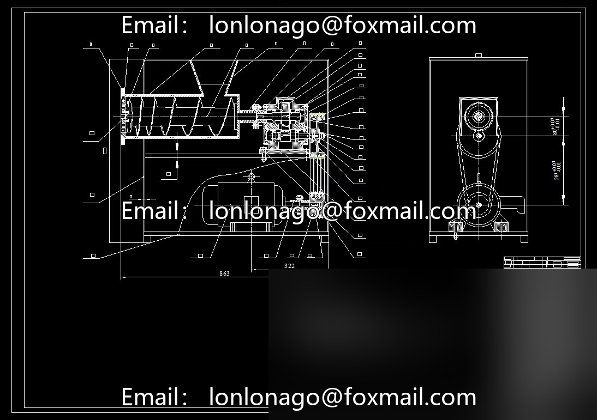
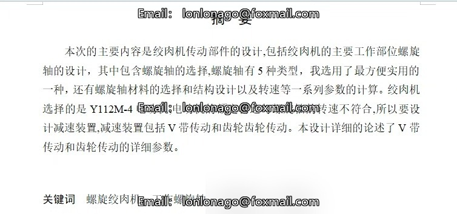
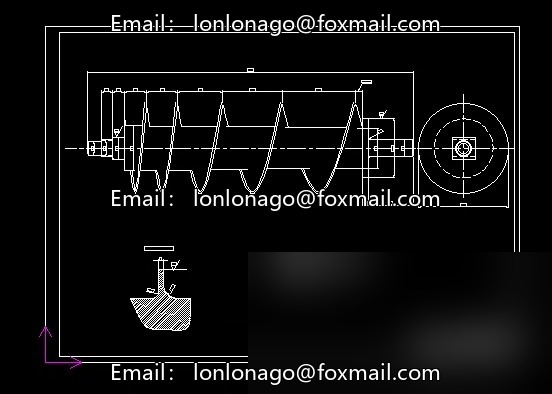
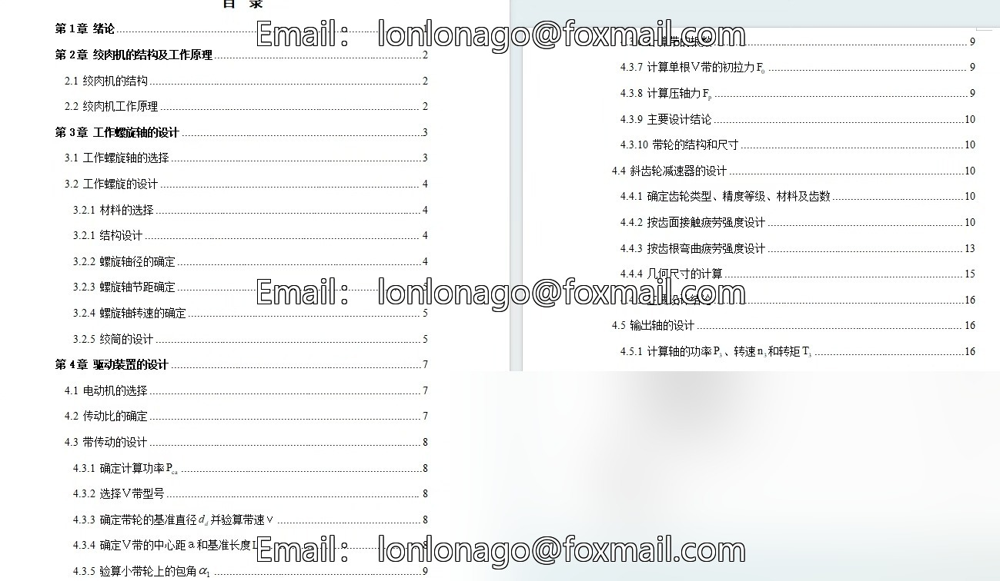
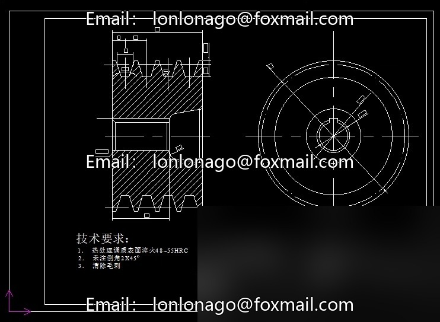

# Screw mill design; screw mill diagram; screw mill design diagram; screw mill C

## Body

Spiral meat mixer design, spiral meat mixer figure, spiral meat mixer design figure, spiral meat mixer CAD figure, spiral meat mixer design CAD figure
437 This design includes the manual and CAD figures, please refer to the figures for specific details.

The design covers the transmission parts of the spiral meat crusher, spiral shaft selection, reduction devices, V-belt and gear drive design, along with the manual and CAD documents.

<!-- AI_ENRICHED -->

## Images

## Payment

Here is a pay link on Stripe ( https://buy.stripe.com/3cs8yP7sY87d0vu9AB ). Please contact me lonlonago@foxmail.com after funding $89, and I will send you a complete data files , thank you!

